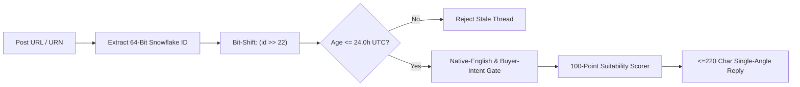

# `snowflake-intent-radar` — Sub-24h Social Buyer-Intent Scanner via 64-Bit Snowflake Math

[](LICENSE)
[](https://www.python.org/)
[](https://github.com/andrew4522-cr/snowflake-intent-radar)

> **Social search filters lie about post age. 64-bit Snowflake math doesn't.** `snowflake-intent-radar` extracts 64-bit Snowflake IDs from LinkedIn (`activity` / `ugcPost` / `share`) and X (`status`) URLs, bit-shifts `(id >> 22)` to verify exact UTC creation timestamps `< 24.0h`, strips out agency/job-seeker noise and auto-translations, and scores genuine founder buyer-distress on a 100-point suitability rubric.

Built by **Andrew Anderson** ([BridgingTheAIGap.com](https://www.bridgingtheaigap.com)).

---

## Why `snowflake-intent-radar` Exists

When you search LinkedIn (`datePosted="past-24h"`) or X/Twitter for people asking for recommendations or hiring, two things ruin your feed:
1. **Stale Resurfaced Posts:** LinkedIn and search engines frequently surface 2-week-old posts because someone commented on them 10 minutes ago.
2. **Supply-Side & Agency Slop:** 85% of posts matching `"looking for"` or `"hiring"` are actually job-seekers (`#opentowork`), agency lead-magnets (*"Comment 'AI' and I'll DM you my template"*), or auto-translated posts from non-target regions.

`snowflake-intent-radar` solves both problems deterministically.

---

## How the 64-Bit Snowflake Timestamp Math Works

Both LinkedIn (`urn:li:activity:<64-bit-int>`) and X/Twitter (`/status/<64-bit-int>`) mint 64-bit Snowflake IDs whose **upper 42 bits** store the exact millisecond creation timestamp:

$$\text{LinkedIn UTC Milliseconds} = \lfloor \text{Snowflake ID} \gg 22 \rfloor$$

$$\text{X/Twitter UTC Milliseconds} = \lfloor \text{Snowflake ID} \gg 22 \rfloor + 1288834974657$$



---

## Core Capabilities

### 1. Mathematical `<24h` Recency Verification (`verify_snowflake_recency`)
- Decodes LinkedIn (`activity`, `share`, `ugcPost`) and X (`status`) URLs into exact UTC creation timestamps and human-readable age badges (`38m ago`, `4.2h ago`).

### 2. Buyer-Intent vs. Supply-Side Noise Filter (`is_valid_buyer_opportunity`)
- **Captures High-Intent Buyer Distress:** `"anyone recommend"`, `"looking for recommendations"`, `"looking for a fractional"`, `"struggling with our"`, `"need help automating"`, and senior remote hiring posts.
- **Rejects 120+ Noise Patterns:** Blocks `#opentowork` job-seeker pitches, `"Comment X and I'll send"` engagement bait, agency self-promotion, podcast promos, and onsite/US-only restrictions.

### 3. Strict Native-English Gate (`is_strictly_native_english`)
- Rejects LinkedIn/X auto-translation banners (`"See translation"`, `"Translated by"`), non-Latin scripts, foreign job-post stopwords, and requires English function-word density.

### 4. 100-Point Multi-Factor Suitability Scorer (`compute_suitability_score`)
Ranks verified opportunities from `0` to `100` across:
- **1st-Degree Connection Priority (`+30 pts`)**
- **Active Help / Process-Distress Request (`+25 pts`)**
- **Geography Fit (`+30 pts`):** Explicit Remote / Worldwide / UK / Europe
- **Decision-Maker Authority (`+25 pts`):** Individual Founder, CEO, COO, CMO, VP, Partner, or Head of
- **Direct Buyer Actionability (`+25 pts`):** Explicit DM/comment/email CTA
- **Core Wheelhouse Depth (`+20 pts`):** Single-angle classification across `AI`, `MARKETING`, or `OPERATIONS`
- **Freshness Decay Curve (`0 to +15 pts`):** First-mover advantage for posts `< 6h` old

---

## Installation

```bash
pip install git+https://github.com/andrew4522-cr/snowflake-intent-radar.git
```

Or clone locally:
```bash
git clone https://github.com/andrew4522-cr/snowflake-intent-radar.git
cd snowflake-intent-radar
pip install -e .
```

---

## Quickstart

### Python SDK

```python
from snowflake_intent_radar import verify_snowflake_recency, evaluate_post

# 1. Decode any LinkedIn or X post URL into its exact UTC creation time
info = verify_snowflake_recency(
    "https://www.linkedin.com/feed/update/urn:li:activity:7392184920184920064/"
)
print(info)
# {'valid_snowflake': True, 'within_window': True, 'created_at_utc': '...', 'age_hours': 2.1, 'age_badge': '2.1h ago'}

# 2. Evaluate a social post across all buyer-intent, native-English, and 100-pt rubric gates
result = evaluate_post(
    text="We are struggling with our HubSpot and n8n workflow automation as we scale across Europe. Can anyone recommend an AI automation architect? DM me!",
    author="Sarah Chen, Founder & CEO",
    company="AcmeAI",
    is_1st_connection=True,
)
print(result["suitability_score"], result["track"], result["suggested_reply"])
```

### CLI Usage

```bash
# Decode a LinkedIn or X URL/URN
snowflake-intent-radar --decode "https://x.com/founder/status/1986401928374659072"

# Evaluate a post end-to-end
snowflake-intent-radar \
  --evaluate "Looking for recommendations for a fractional CMO or growth lead (Remote UK/Europe) to help us fix attribution and paid acquisition ROAS. Drop a comment or DM me!" \
  --author "James Miller, Co-Founder & CEO"
```

---

## Running Tests

```bash
python -m unittest discover -s tests -v
```

---

## License

MIT License © 2026 [Andrew Anderson](https://www.bridgingtheaigap.com)
